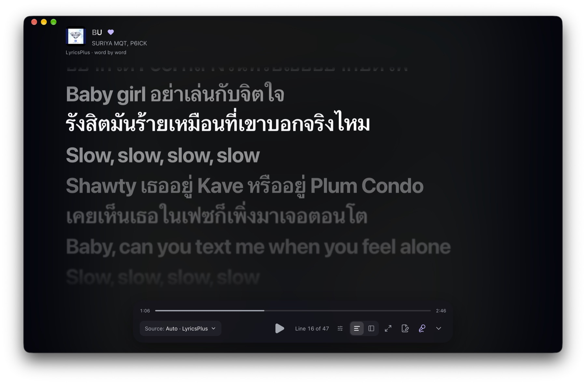

<div align="center">


# LunoRX

A music player for YouTube Music on iPhone, iPad and Android. A Rust core handles search, playback, the queue and sync, and the interface only shows what the core can actually do.

> This is the mobile build. It shares its core and interface with the desktop app but plays through AVPlayer (iOS) and Media3 (Android) instead of libmpv. How it differs, how to build it and what has and has not been verified: [`MOBILE.md`](MOBILE.md). Sections below that describe desktop-only behaviour (libmpv, macOS menu, Discord, keyboard shortcuts) do not apply here.

`Tauri 2` · `Rust (edition 2024)` · `Next.js 16 static export` · `React 19` · `AVPlayer` · `Media3` · `iOS 15+ and Android 7+`

</div>

---

> **Pre-release (`1.0.0-rc.0`).** It plays real YouTube audio on a developer machine. Spotify search and playback are not supported, and no installer has been tested on a clean machine yet. The [Status](#status) table lists what works and what does not.

> [!IMPORTANT]
> ### Disclaimer
>
> **No affiliation.** LunoRX and its contributors are not affiliated with, authorized by, endorsed by, or in any way officially connected with Google LLC, YouTube, YouTube Music, Spotify AB, or any of their subsidiaries or affiliates. The same goes for the lyric services the app can query (LRCLIB, LyricsPlus, Netease Cloud Music, QQ Music, Kugou, Boidu). This is an independent, unofficial, open-source project.
>
> **Trademarks.** "Google", "YouTube", "YouTube Music", "Spotify" and all related names, marks, emblems and images are registered trademarks of their respective owners. They are used here only for identification and reference and do not imply any association with, or endorsement by, the trademark holders. There is no intention to infringe on these trademarks or to harm their owners.
>
> **Third-party services.** The app talks to YouTube Music directly and, for lyrics, to several unofficial endpoints. These services have their own terms and may change, restrict or stop working without notice. You are responsible for using the app in a way that complies with the terms that apply to you. [Security model](#security-model) and [Lyrics](#lyrics) describe exactly what is sent where.
>
> **Limitation of liability.** The software is provided "AS IS", without warranty of any kind, and you use it at your own risk. In no event shall the authors or contributors be liable for any claim, damages or other liability, including any legal consequences, whether in an action of contract, tort or otherwise, arising from, out of or in connection with the software or the use of or other dealings in it. You are responsible for any outcome of using this software. The [MIT licence](LICENSE) covers the code in this repository.

## Contents

- [Screenshots](#screenshots)
- [What it is](#what-it-is)
- [Features](#features)
- [Status](#status)
- [Quick start](#quick-start)
- [Develop the interface](#develop-the-interface)
- [Architecture](#architecture)
- [Repository layout](#repository-layout)
- [The IPC surface](#the-ipc-surface)
- [Playback pipeline](#playback-pipeline)
- [Lyrics](#lyrics)
- [Security model](#security-model)
- [Design system](#design-system)
- [Keyboard shortcuts](#keyboard-shortcuts)
- [Quality gates and tests](#quality-gates-and-tests)
- [Releasing](#releasing)
- [Known limits](#known-limits)
- [Project documents](#project-documents)

## Screenshots

<table>
  <tr>
    <td width="50%"><br><sub>Listen Now: history, the library in the sidebar, and a player bar showing the real up-next queue.</sub></td>
    <td width="50%"><br><sub>Playlist Editor: playlists live on this device first, and you choose when to keep them offline or upload them.</sub></td>
  </tr>
  <tr>
    <td width="50%"><br><sub>Full-window lyrics with word-by-word highlighting from LyricsPlus, a source picker and a line counter.</sub></td>
    <td width="50%"><br><sub>Split lyrics view, with the cover and track details beside the text.</sub></td>
  </tr>
</table>

Full-size originals are in [`assets/`](assets/). All four were taken on macOS with real YouTube Music data.

## What it is

LunoRX is a desktop-first music player built around one library that can hold tracks from more than one provider. Each playlist entry records which provider it came from. Your data lives on your machine first. An optional backend that you can host yourself syncs playlists between devices, and the app works without it.

Three rules shape the code:

1. A capability counts as supported only after someone verified it. Unknown means unsupported. A track is `PLAYING` once the player confirms it, not when a Play command is sent.
2. The core owns the state. Search, playback, the queue and sync live in Rust. The React UI draws that state and sends commands, and it keeps no second copy of the queue.
3. App sign-in (the sync backend) and provider sign-in (YouTube) are separate. Provider credentials stay in the OS key store on this machine.

## Features

**Listening**
- Native audio through libmpv: seek, volume, resume where you left off, stream quality, loudness, PCM format and sample rate.
- Autoplay radio. When a track ends, the core has already prepared the next related track and starts it. The up-next list is real, you can pick from it, and Previous uses it.
- Play, Shuffle and Save to playlist on every album and artist page. The core queues the remaining tracks as Up next.
- On macOS: the Now Playing widget, media keys and a Playback menu in the menu bar.
- Offline: keep a playlist on the device. A disk cache with a size limit handles everything else.

**Finding music**
- Home (history and recommendations), Explore (Discover, Thai music, Pop, Hip-hop, Focus, Chill, Acoustic), and Search with live suggestions. A newer search cancels the one before it.
- Library with liked songs, artists (with profile photos), albums and local playlists.
- Artist and album pages with real profiles, discographies and track lists.
- A command palette on `⌘K` / `Ctrl+K`.

**Lyrics**
- Time-synced lyrics in a full-window layout, with an active line, gaps for intros and instrumentals, and click to seek.
- Eight sources in an order you set: LyricsPlus, LRCLIB, YouTube Music, Netease, QQ Music, Kugou, Boidu and your own files. Word-by-word timing appears where a source provides it. Where it does not, a labelled "guessed" mode is available.
- A source picker, a timing offset per source, and "Wrong song? Search by title" with a manual bind.
- Lyric Maker: play a song and type or tap along to write a `.lrc` file. A calibration pass measures your input delay. Files are plain text in `~/Documents/LUNOR-X Lyrics/`.

**Your data**
- Local-first playlists with an offline queue and version numbers for optimistic concurrency. When a conflict comes up, you choose to keep yours or the server's, and nothing is overwritten silently.
- Optional sync with a LUNOR-X backend.

**Interface**
- A dark glass-and-blur theme with one accent colour, which means "live". Motion follows `prefers-reduced-motion`, and transparency follows `prefers-reduced-transparency`. The target is WCAG 2.2 AA.
- Covers are prefetched. Home and Explore feeds persist, so they draw immediately and refresh behind the rows. Artist photos are cached on disk.

## Status

| Area | State |
|---|---|
| YouTube Music search | Works. Direct, no API key. |
| YouTube audio playback | Works through libmpv on a developer machine. libmpv must be installed. |
| YouTube sign-in | Google session cookies in the OS key store. This is a project-owner exception, described under [Security model](#security-model). It is not approval from the provider. |
| Spotify | Not supported. No search and no playback. The app reports it as unsupported. |
| Lyrics | Five unofficial endpoints, used with the owner's acceptance. Each one can be turned off. See [Lyrics](#lyrics). |
| Sync with the backend | Works against a running backend (sign in, create, add, upload). Not production-hardened. |
| Library: albums and songs tabs | Partly sample data, labelled as a demo in the UI. Playlists and likes are real. |
| macOS bundle | Bundling has been run locally, on a debug build only. |
| Windows and Linux | Targets. Not verified on real machines. Linux sign-in needs a Secret Service (GNOME Keyring or KWallet). |
| Release signing | macOS apps are ad-hoc signed unless signing secrets are set. Windows installers are unsigned. |
| Licences | `rustypipe` is GPL-3.0 and `libmpv` is LGPL. [THIRD_PARTY_NOTICES.md](THIRD_PARTY_NOTICES.md) lists every component and licence. The GPL-3.0 question for the combined work is **not resolved**, so do not publish a public release before it is. |

## Quick start

### Requirements

| Tool | Used for |
|---|---|
| Rust stable with edition 2024 (`cargo`, `rustfmt`, `clippy`) | The core and the Tauri shell |
| Bun, or Node 22 with npm | The frontend. `tauri.conf.json` calls `bun run dev` and `bun run build`, so Bun has to be on the `PATH` for `tauri dev` and `tauri build` as configured |
| Tauri 2 platform prerequisites | See the Tauri docs for your OS |
| libmpv | Native playback. On macOS: `brew install mpv` |
| A Secret Service (Linux only) | GNOME Keyring or KWallet, to store the sign-in token |

On Linux the build also needs `build-essential pkg-config libssl-dev libdbus-1-dev libwebkit2gtk-4.1-dev libayatana-appindicator3-dev librsvg2-dev`.

Building, running and testing need no secrets.

### Run it

```sh
bun install            # or: npm ci
bun run tauri dev      # starts next dev on :1420, then the native app
```

The app starts without a backend. Sync actions report an error category until a backend answers at `http://127.0.0.1:8080`, the default base URL in `src-tauri/src/sync/settings.rs`.

### Build it

```sh
bun run build          # next build, static export to out/
bun run tauri build    # bundles for the current OS
```

`out/` has to exist before any Rust build of the crate, because `tauri::generate_context!` embeds it (`frontendDist: ../out`). Without it the Rust build fails.

## Develop the interface

```sh
bun run tauri dev      # the interface inside the native app, with hot reload
```

The interface talks to the Rust core through Tauri IPC, so run it inside the app. `bun run dev` alone serves the pages in a browser, but there is no core behind them: every command fails, and the screens show their error states.

## Architecture

```
┌──────────────────────────────────────────────────────────────┐
│  Desktop UI  (src/)    Next.js static export · React 19      │
│  presentation · navigation · input · login UI                │
└───────────────┬──────────────────────────────────────────────┘
                │  Tauri IPC (typed DTOs, validated arguments)
┌───────────────▼──────────────────────────────────────────────┐
│  Commands  (src-tauri/src/commands/)   thin boundary         │
│  validate input → call core → return DTO. No business logic. │
└───────────────┬──────────────────────────────────────────────┘
                │
┌───────────────▼──────────────────────────────────────────────┐
│  Core  (src-tauri/src/core/)        no UI, no Tauri types    │
│  search · playback state machine · queue · lyrics ·          │
│  library · discovery · provider registry · caches            │
├──────────────────────────────────────────────────────────────┤
│  Sync  (src-tauri/src/sync/)   backend client: auth,         │
│  local store, offline queue, conflicts                       │
├──────────────────────────────────────────────────────────────┤
│  Platform  (src-tauri/src/platform/)   macOS media, menu     │
└──────────────────────────────────────────────────────────────┘
                │  HTTP (optional)
        LUNOR-X backend   accounts + playlists only
```

The dependency rules are checked in review:

- The UI calls the core through IPC. The desktop reaches the backend only through `sync/`.
- Domain logic in the core uses no UI framework and no Tauri-specific API, so it can be tested without a window.
- Commands stay thin. Business logic goes in the core.
- The frontend does not re-implement search or playback orchestration.
- Provider details stay out of the generic playlist and queue models. An id from one provider is never used for another, and results are never merged by title alone.

## Repository layout

```
desktop/
├─ src/                      frontend
│  ├─ app/                   Next.js entry, global CSS and design tokens
│  ├─ components/            shared UI, layout shell (Sidebar, TopBar, players)
│  ├─ features/              one folder per screen: home, explore, search,
│  │                         library, artists, playlists, queue, player,
│  │                         settings, sync, accounts, connections, offline…
│  ├─ lib/                   stores (Zustand), playback, lyrics, prefetch, app style
│  └─ services/tauri/        one typed wrapper per IPC command group
├─ src-tauri/
│  ├─ src/core/              domain, search, playback/, lyrics, library, discovery
│  ├─ src/commands/          IPC handlers: player, search, library, lyrics, sync…
│  ├─ src/sync/              backend client, local store, offline queue
│  ├─ src/platform/          macOS Now Playing, media keys, menu
│  ├─ capabilities/          Tauri permission sets
│  ├─ build.rs               declares the app manifest (every command, by name)
│  └─ tests/                 ACL guards per command group, opt-in live tests
├─ tests/                    frontend tests (bun:test)
├─ scripts/release/          release helpers
├─ .github/workflows/        release workflow
├─ AGENTS.md  CLAUDE.md       rules for coding agents working here
├─ PRODUCT.md  DESIGN.md     product context and the visual system
└─ RELEASING.md              how a release is made
```

## The IPC surface

A new command has to be registered in four places, and a test fails if one is missing:

1. the handler in `src-tauri/src/commands/*.rs`
2. `generate_handler!` in `src-tauri/src/lib.rs`
3. the command name in `src-tauri/build.rs` (`AppManifest::commands`)
4. `allow-<command-name>` in `src-tauri/capabilities/default.json`

The `tests/acl_*.rs` files read those files and check that every handler in a group is both declared and allowed. Arguments are validated at the boundary (sizes, id shapes, ranges). Errors cross IPC as fixed categories, without raw messages or stack traces.

| Group | Commands |
|---|---|
| Player | `player_load` `player_play` `player_pause` `player_resume` `player_stop` `player_seek` `player_set_volume` `player_state` `player_progress` `player_skip` `player_observe` `player_track_info` `player_open_external` `player_audio_settings` `player_set_audio_settings` |
| Search and discovery | `search_query` `search_cancel` `search_suggestions` `discovery_feed` `providers_list` |
| Library | `library_likes` `library_set_like` `library_artist` `library_album` `library_history` `library_clear_history` |
| Lyrics | `lyrics_source_fetch` `lyrics_source_search` `lyrics_source_bind` `lyrics_source_unbind` `lyrics_settings_get` `lyrics_settings_set` · `lrc_load` `lrc_save` `lrc_delete` `lrc_reveal` `lrc_list` |
| Sync | `sync_sign_in` `sync_sign_out` `sync_status` `sync_create_local_playlist` `sync_add_local_entry` `sync_remove_local_entry` `sync_upload_playlist` `sync_flush_pending` `sync_discard_pending` `sync_resolve_conflict` `sync_list_local_playlists` |
| Providers | `youtube_connect` `youtube_connect_finish` `youtube_disconnect` `youtube_connection_status` `provider_credential_set` `provider_credential_status` `provider_credential_clear` |
| Offline | `offline_status` `offline_keep` `offline_cancel` `offline_remove` `offline_set_limit` |

Events come back through the same typed channel: `core://player/state`, `core://player/progress`, `core://library/changed`, `core://history/changed`, `core://history/error`, `core://offline/changed` and `core://youtube/connection`. Each subscription is removed when its component unmounts.

## Playback pipeline

```
UI intent ─► player_load ─► core state machine ─► native host (libmpv)
                                  ▲                      │
                                  └── confirmed events ──┘
```

- The state machine rejects stale events by revision number, and the UI draws only what the core has confirmed.
- RustyPipe resolves YouTube audio, a bounded-range loopback proxy fetches it, and libmpv plays it. This path relies on the project-owner exception described under [Security model](#security-model).
- Autoplay is a single bounded radio session, and the host's confirmed end-of-file is the only thing that advances it. The next track is prepared, and its lyrics prefetched, before it is needed. Preparation has a timeout and a bounded retry.
- Volume and seek commands are latest-wins, so dragging a slider does not queue stale commands.
- The offline cache is a disk cache with a size limit. Playlists you keep offline are pinned and never evicted.

## Lyrics

Sources are tried in the order you set. The default order is your own file, then word-timed sources, then line-timed ones, then plain text.

| Source | Provides | Notes |
|---|---|---|
| My LRC | Line timing | Files made with Lyric Maker |
| LyricsPlus | Word timing | A cold request can take several seconds. Use "Try again" in the source sheet |
| Netease | Word and line timing | Supports search by title |
| LRCLIB | Line timing, plain text | Fuzzy matching with duration checks |
| QQ Music | Line timing | Supports search by title |
| Kugou | Line timing | Supports search by title |
| Boidu | Word timing | Answers only for tracks it has cached |
| YouTube Music | Plain text | No timestamps |

- Only public track metadata (title, artists, length) goes to these services. No cookie, token or account data does.
- Most of these endpoints are unofficial and could change or disappear. You can turn each source off under Settings > Playback & audio. Results are cached, and misses are remembered for 24 hours, so the app does not keep asking for lyrics a service does not have.
- A line without a real timestamp is never shown as timed. Estimated and guessed timing carries a label ("estimated timing", "words guessed"), and word highlighting is real only when the source supplies word times.
- The lyric-source code lives in `src-tauri/src/core/playback/lyric_sources/`.

## Security model

- **IPC.** Every command is declared and allowed, and its arguments are validated. Native permissions are not exposed to remote content.
- **Content Security Policy.** `style-src 'self'` with no inline styles, `script-src` limited to the app and YouTube, and images only from the app, `data:` and the known thumbnail hosts. This is why motion code mounts on the client only.
- **Credentials.** YouTube session cookies and the sync token live in the OS key store (Keychain, Credential Manager, Secret Service). The app does not write them to disk, log them, send them to the backend or show them in the UI. Where no secure store exists (Linux without a Secret Service), the feature fails closed. There is no in-memory or plaintext fallback.
- **Secrets in the binary.** None are shipped.
- **Ownership.** The server decides who owns what. The client never asserts a user id.
- **The YouTube exception.** Provider guidelines normally forbid stream extraction and cookie use. For YouTube, the project owner chose native extraction and Google-session sign-in instead of OAuth2, and `AGENTS.md` records that decision. It is a decision by the project, and the provider has not approved it. Spotify has no such exception and is unsupported.
- To report a vulnerability, read [SECURITY.md](SECURITY.md). Please do not open a public issue.

## Design system

The theme is dark glass and blur with one accent, Lumen Lavender (`#c5b4ff`), which marks live state and nothing else. Panels have no borders. Only the sidebar and the player bar use blur, and everything else is flat. Components are `ln-` classes plus Tailwind v4 tokens declared in `src/app/globals.css`.

- Product context: [PRODUCT.md](PRODUCT.md)
- Visual system, tokens and component rules: [DESIGN.md](DESIGN.md)

Read both before UI work. Loading, empty, unavailable, unauthorized, unsupported, failed, retrying and offline each have their own look, and an unsupported action is explained on screen instead of being hidden.

## Keyboard shortcuts

| Action | macOS | Windows / Linux |
|---|---|---|
| Quick search and commands | `⌘K` | `Ctrl+K` |
| Back / Forward | `⌘[` / `⌘]` | `Ctrl+[` / `Ctrl+]` |
| Collapse the sidebar | `⌘B` | `Ctrl+B` |
| Play or pause (not while typing) | `Space` | `Space` |
| Close Now Playing, palette or dialog | `Esc` | `Esc` |

Lyric Maker and the macOS Playback menu have their own shortcuts, listed under Settings > Keyboard shortcuts.

## Quality gates and tests

Run the gates for the part you changed. The policy is zero warnings. Blanket `#[allow]` is not accepted, and a targeted one needs the smallest possible scope and a one-line reason. Use `--locked`, and do not update dependencies to silence a lint.

Rust, from `src-tauri/`:

```sh
cargo fmt --check
cargo clippy --locked --all-targets -- -D warnings
cargo test --locked
```

Frontend, from the repository root:

```sh
bun run lint           # tsc --noEmit
bun run build          # next build, static export
bun test tests/        # frontend tests (bun:test)
```

| Suite | What it covers |
|---|---|
| Unit tests (`#[cfg(test)]` next to the code) | Domain, search engine, playback state machine, queue, autoplay, lyrics matching and parsing, lyric sources against local mock servers, library, sync engine, persistence, and the token store (an in-memory double, so tests never touch the real keychain) |
| `tests/acl_*.rs` | Every command is in the manifest and allowed in the capability set |
| `tests/backend_sync_live.rs` | A real sign-in and playlist flow. Runs only when `LUNORX_LIVE_BACKEND_URL` is set, and otherwise skips |
| `tests/youtube_live.rs` | Live YouTube Data API search. Runs only when `LUNORX_LIVE_YOUTUBE_KEY` is set, and otherwise skips |
| `tests/*.test.mjs` | Frontend store logic |

The last full Rust run, on 2026-10-22, passed 555 tests with no failures. Run it yourself for a current number.

Not covered: end-to-end UI tests, a release bundle run on Windows or Linux, load tests, and playback against a real player in CI.

## Releasing

A release is a version tag. Pushing the tag builds the installers and publishes them with `SHA256SUMS.txt`. The version lives in `package.json` and `src-tauri/Cargo.toml`, and the workflow rejects a tag that does not match both. [RELEASING.md](RELEASING.md) has the full steps, the platform table and the signing secrets.

## Known limits

- libmpv has to be installed to run from source. Release bundles are meant to ship it, but that has only been tried on macOS, on a debug build.
- An artist photo needs a full artist profile request. The app makes two at a time and remembers the results, so the first run with many liked artists fills in gradually.
- The unofficial lyric endpoints may change or disappear at any time.
- The first request to LyricsPlus can be slow and may need one retry.
- SimpMusic is not supported, because its server answers only its own client.
- The Library's albums and songs tabs include sample data, labelled in the UI.
- Playlist track lists cannot be read back from the local store yet. The editor shows counts and status.
- The GPL-3.0 licence of `rustypipe` conflicts with the MIT licence declared for this repository. See [THIRD_PARTY_NOTICES.md](THIRD_PARTY_NOTICES.md).

## Project documents

| File | Purpose |
|---|---|
| [AGENTS.md](AGENTS.md) | Working rules: architecture, hard rules, commands, definition of done |
| [CLAUDE.md](CLAUDE.md) | Notes for Claude Code sessions |
| [PRODUCT.md](PRODUCT.md) | Who the app is for and what it must not become |
| [DESIGN.md](DESIGN.md) | Tokens, components, motion and accessibility rules |
| [CONTRIBUTING.md](CONTRIBUTING.md) | Branching and quality gates |
| [RELEASING.md](RELEASING.md) | Tags, installers, signing |
| [SECURITY.md](SECURITY.md) | How to report a vulnerability (privately, through GitHub) |
| [THIRD_PARTY_NOTICES.md](THIRD_PARTY_NOTICES.md) | Components, licences and what needs attention |
| [CODE_OF_CONDUCT.md](CODE_OF_CONDUCT.md) | Community rules |
| [LICENSE](LICENSE) | MIT, covering this repository's own code only |

## Star History

[](https://star-history.com/#LunoRX-RS/desktop&Date)
